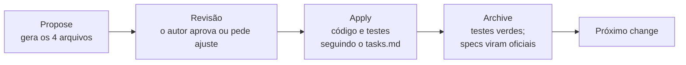

# Guia do fluxo OpenSpec neste projeto

Guia de consulta rápida sobre como o projeto é evoluído com Spec-Driven Development (SDD) e OpenSpec. Os exemplos vêm do próprio projeto.

## 1. A ideia central

Antes de mexer no código, escreve-se num arquivo **o que** vai mudar. Depois muda-se o código. No fim, os testes conferem se o código faz o que estava escrito.

Exemplo com um defeito real do projeto: ao cadastrar um gasto de R$ 80,00, a API mostrava `8000.0`.

1. **Escrever:** "Quando eu cadastrar 8000 centavos, a API deve mostrar 80.00."
2. **Corrigir o código.**
3. **Testar:** cadastrar 8000 e conferir se aparece 80.00.

O OpenSpec é a ferramenta que organiza o passo 1 em arquivos com nomes e formatos fixos.

## 2. Os 4 arquivos de um change

Cada mudança no projeto é um **change**, uma pasta em `openspec/changes/<nome>/` com quatro arquivos. Leia sempre nesta ordem, porque cada um depende do anterior:

| Ordem | Arquivo | Pergunta que responde | Como ler |
|---|---|---|---|
| 1 | `proposal.md` | **Por que** mudar, e o que entra ou fica de fora? | Como um gerente: concordo com o motivo e com o escopo? |
| 2 | `specs/<capability>/spec.md` | **O que** o sistema deve fazer, visto de fora? | Como quem testa: consigo imaginar um teste para cada cenário? |
| 3 | `design.md` | **Como** fazer, e por que desse jeito? | Como quem vai explicar a decisão numa entrevista |
| 4 | `tasks.md` | **Quais passos**, e como sei que terminei? | Como um checklist |

O mesmo exemplo do valor, passando pelos quatro arquivos:

- **`proposal.md`:** "A API mostra 8000.0 quando deveria mostrar 80.00. Quem usa vê o valor errado."
- **`spec.md`:** "Quando eu cadastrar 8000, a API deve mostrar 80.00."
- **`design.md`:** "Usar `BigDecimal.valueOf(amount, 2)` no `TransactionOutput`, porque a conta é exata. Alternativa rejeitada: dividir por `100.0`, que usa `double` e pode arredondar errado."
- **`tasks.md`:** "[ ] Escrever o teste que espera 80.00. [ ] Alterar o `TransactionOutput`. [ ] Rodar `./gradlew test`."

## 3. Como uma spec é escrita

Uma spec descreve **comportamento visível de fora** do sistema, nunca nomes de classes. A estrutura é sempre:

- `### Requirement:` é uma regra, escrita com **SHALL** ("o sistema deve").
- `#### Scenario:` é um exemplo concreto da regra, em **WHEN** (quando acontecer isto) / **THEN** (então espero aquilo).

```markdown
### Requirement: Valor em reais na saída
O sistema SHALL devolver o valor em reais, com duas casas decimais.

#### Scenario: Valor em centavos convertido para reais
- **WHEN** uma transação é registrada com `amount` igual a `8000`
- **THEN** a resposta mostra `amount` igual a `80.00`
```

Cada cenário vira um teste quase palavra por palavra:

```java
@Test
void givenAmountInCentsWhenConvertingThenShowsReais() {
    final var transaction = new Transaction(
            new OwnerId(), "Mercado", 8000, Category.GROCERIES);

    final var output = TransactionOutput.from(transaction);

    assertThat(output.value()).isEqualTo(new BigDecimal("80.00"));
}
```

Se não dá para imaginar um teste para o cenário, ele está mal escrito.

## 4. O ciclo de um change



| Fase | Comando | O que acontece | Muda código? |
|---|---|---|---|
| Propose | `/opsx-propose` | Gera `proposal`, `specs`, `design` e `tasks` | Não |
| Revisão | (leitura) | O autor lê e aprova ou pede ajustes | Não |
| Apply | `/opsx-apply` | Executa o `tasks.md`, marcando `[x]` em cada tarefa | Sim |
| Archive | `/opsx-archive` | Aplica os deltas nas specs oficiais e move o change para `archive/` | Não |

Três pastas resumem o estado do OpenSpec:

- `openspec/changes/<nome>/`: o change que está **em andamento**, com proposta, deltas, design e tarefas;
- `openspec/specs/`: a **verdade oficial atual**, organizada por capacidade e atualizada no archive;
- `openspec/changes/archive/<data>-<nome>/`: o histórico completo dos changes concluídos.

As specs principais não guardam cada etapa do desenvolvimento. Elas acumulam o resultado final de vários changes e respondem “como o sistema deve funcionar hoje?”. Para entender por que uma regra existe, quais alternativas foram descartadas ou quais tarefas foram executadas, consulte o change correspondente no archive.

Exemplo: `openspec/specs/transactions/spec.md` contém hoje a regra de isolamento por proprietário. A motivação, as decisões e as 22 tarefas que introduziram essa regra estão preservadas em `openspec/changes/archive/2026-10-30-add-transaction-ownership/`.

Uma analogia útil:

- `specs/` é a legislação vigente;
- `changes/` contém os projetos de lei em análise;
- `archive/` preserva o histórico das leis aprovadas.

## 5. Deltas: como uma spec muda

Um change não reescreve a spec inteira. Ele traz só a **diferença** (delta) em relação à spec oficial:

| Seção | Quando usar | Exemplo no projeto |
|---|---|---|
| `## ADDED Requirements` | Regra nova | Change 0 criou todas as regras da linha de base |
| `## MODIFIED Requirements` | Regra alterada, mantendo o nome e **todos** os cenários antigos | Ajustar um detalhe de uma regra existente |
| `## REMOVED Requirements` | Regra que deixa de existir (exige **Reason** e **Migration**) | Change 1 removeu "Representação do valor na saída (D-01)" |

**Lição do change 1:** o validador recusou um `MODIFIED` que renomeava os cenários antigos, porque o `MODIFIED` substitui o bloco inteiro e não pode descartar cenários. Quando o comportamento muda de natureza (o defeito deixa de existir), o caminho limpo é **REMOVED** da regra antiga + **ADDED** de uma regra nova, com nome que descreve o comportamento correto:

- Saiu: "Representação do valor na saída (D-01)"
- Entrou: "Valor em reais na saída"

**Lição do change 1b:** uma refatoração não muda comportamento, então não tem delta de spec. Mas o validador recusa um change sem nenhum delta. O caminho é declarar `skip_specs: true` no `.openspec.yaml` do change, sem inventar requisito só para passar na validação. Foi o caso do `move-ai-tools-to-infrastructure`, em que a prova de que nada mudou veio de um teste de caracterização: um teste que congela o comportamento atual antes de mexer no código.

### Por que a linha de base descreve defeitos

O change 0 (`baseline-specs`) registrou o sistema **como ele era**, inclusive os defeitos, cada um com seu ID (D-01, D-03...). Assim, cada change seguinte mostra o antes e o depois no histórico. Os IDs D-01 a D-07 estão definidos em `docs/proposta-inicial.md`, seção 2.

Defeitos que não mudam o que o cliente vê (D-02, organização do código; D-04, suíte de testes) não viram requisito de spec. Eles ficam no `design.md` e no `tasks.md`.

## 6. Onde ficam os padrões de código

| Arquivo | O que define | Exemplo |
|---|---|---|
| `AGENTS.md` | Regras gerais do projeto inteiro | "O controller só adapta HTTP e chama um caso de uso" |
| `docs/padrao-de-testes.md` | Como escrever os testes | Nomes `Given ... When ... Then ...`, helpers `setupGiven`/`verifyGiven` |
| `openspec/config.yaml` | Regras aplicadas a todo change | "Use apenas padrões e tecnologias ensinados na trilha" |
| `docs/proposta-inicial.md` | Requisitos, escopo e decisões | Seção 3.3: tecnologias permitidas |
| `design.md` (de cada change) | Como aplicar os padrões naquele caso | "A conversão fica no `TransactionOutput`" |

Resumo: **os padrões gerais estão no `AGENTS.md` e nos docs, a decisão de cada change está no `design.md`, e quem confirma que deu certo são os testes.**

Uma regra para o projeto inteiro (por exemplo, proibir uma biblioteca) vai no `AGENTS.md` e no `config.yaml`, não num change.

## 7. Onde entra a escolha de tecnologias

O OpenSpec não tem uma fase própria para escolher a stack. Ela é decidida antes e entra como contexto, ou é decidida no `design.md` de um change.

- **Neste projeto:** a stack foi herdada do módulo `05-spring-ai` e registrada na proposta inicial (seções 1.3 e 3.3), no `AGENTS.md` e no `config.yaml`.
- **Num projeto do zero:** `openspec init`, depois um primeiro change (por exemplo, `setup-project`) cujo `design.md` registra as escolhas com o motivo e as alternativas rejeitadas. Depois do archive, as escolhas vão para o `config.yaml`.
- **Tecnologia nova no meio do caminho:** entra pelo `design.md` do change que precisar dela e, neste projeto, exige aprovação do autor (foi assim com o Instancio).

Equivalência com o Spec Kit:

| O que se define | Spec Kit | OpenSpec |
|---|---|---|
| Princípios e regras do projeto | `/speckit.constitution` | `config.yaml` e `AGENTS.md` |
| O que o sistema deve fazer | `/speckit.specify` | `proposal.md` e `spec.md` |
| Tecnologias e como fazer | `/speckit.plan` | `design.md` |
| Checklist | `/speckit.tasks` | `tasks.md` |
| Implementação | `/speckit.implement` | `/opsx-apply` |

## 8. Comandos do dia a dia

| Comando | Para que serve |
|---|---|
| `openspec list` | Changes em andamento e progresso das tarefas |
| `openspec list --specs` | Specs oficiais e quantos requisitos cada uma tem |
| `openspec status --change <nome>` | Quais artefatos do change já existem |
| `openspec validate <nome> --strict` | Confere o formato do change (cenários, deltas, cabeçalhos) |
| `openspec show <nome>` | Mostra um change ou uma spec |
| `openspec archive <nome>` | Aplica os deltas nas specs oficiais e arquiva o change |

## 9. Os changes deste projeto

Os primeiros changes seguem a ordem da seção 5 da proposta inicial. As evoluções de IA e segurança vieram depois, sempre começando após o archive do change anterior.

| # | Change | Conteúdo |
|---|---|---|
| 0 | `baseline-specs` | Descrever o sistema como era, inclusive os defeitos |
| 1 | `fix-base-defects` | Valor em reais, prompt em UTF-8, suíte de testes executável |
| 1b | `move-ai-tools-to-infrastructure` | Tirar as anotações do Spring AI dos casos de uso (adaptador em `infrastructure/ai`) |
| 2 | `add-transaction-validation` | Validação dos dados e tratamento de erros |
| 3 | `add-transaction-timestamp-and-categories` | Data de criação e novas categorias |
| 4 | `add-financial-query-tools` | Total por categoria e consulta por período |
| 5 | `extract-voice-command-use-case` | Tirar a IA do controller e criar o endpoint de texto |
| 6 | `improve-assistant-prompt` | Prompt melhor para a IA |
| 7 | `document-api` | Documentação da API e README final |
| 8 | `improve-registration-category-inference` | Inferência de categoria a partir da descrição |
| 9 | `restrict-assistant-to-financial-scope` | Restrição do assistente ao escopo financeiro |
| 10 | `add-user-accounts-and-authentication` | Contas, aprovação, papéis e autenticação por sessão |
| 11 | `add-transaction-ownership` | Propriedade obrigatória e isolamento dos gastos por usuário |

Para saber onde o projeto está agora, rode `openspec list` e veja `openspec/changes/archive/` (o que já foi concluído).
